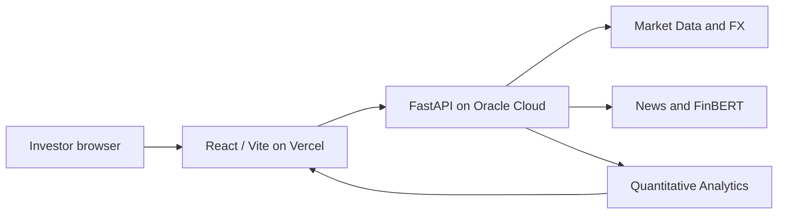

# FinClarity

**Portfolio intelligence for retail investors and institutional-style research.**

[Live platform](https://finclarity-ebon.vercel.app) · [API health](https://finclarity-api.duckdns.org/api/health)

FinClarity is a full-stack investment research platform bringing together portfolio analytics, historical market data, financial-news sentiment and quantitative allocation models in two connected experiences: **Retail Investor** and **Institutional Investor**. Built as a finance and software-engineering portfolio project, it emphasises clear methodology, data-quality disclosures and useful decision-support interfaces.

> **Project status — October 2026:** The frontend is deployed on Vercel; the FastAPI backend is hosted on Oracle Cloud. Six institutional analytics APIs have been observed returning successful HTTP responses. **171 local Python tests passed**, and the frontend production build succeeded. The updated backtesting accounting is committed to GitHub but **not yet deployed to Oracle**.

## Explore the platform

| Retail Investor | Institutional Investor |
| --- | --- |
| Portfolio entry and CSV import | Shared portfolio, manual entry and CSV import |
| Dashboard and Portfolio Health | Efficient Frontier and allocation optimisation |
| Risk Analysis and stress scenarios | Risk Analytics and factor rankings |
| Sentiment Insights and news evidence | Sentiment Intelligence and Black–Litterman |
| Diversification and Exposure Intelligence | Walk-forward Backtesting and Model Settings |
| Action Centre and educational explanations | Research-oriented configuration and model outputs |

Retail and Institutional have distinct navigation and mobile layouts. Broker and PMS/OMS linking interfaces are **planned integrations, not operational connections**.

## How it works

### Retail workflow

1. Enter holdings manually or import a CSV, and select a display currency.
2. View holdings, portfolio market value and composition.
3. Run analysis to produce risk, sentiment and portfolio-health diagnostics.
4. Explore performance, diversification, exposure, stress testing and prioritised attention items.
5. Use plain-language explanations to understand findings and limitations.

### Institutional workflow

1. Save a shared portfolio used across institutional analytics modules.
2. Estimate risk and evaluate mean–variance allocation alternatives.
3. Inspect financial-news sentiment and confidence by ticker.
4. Construct Black–Litterman views from sentiment and uncertainty.
5. Compare factor rankings and walk-forward strategy results against benchmarks.

When portfolio inputs change, the UI can mark saved model outputs as stale rather than silently presenting them as current.

## Quantitative methodology

| Module | Approach | Key caveat |
| --- | --- | --- |
| Performance | Historical constant-weight daily-rebalanced simulation | Not an investor's actual realised P&L |
| Risk Analytics | Volatility, Sharpe/Sortino, drawdown, historical VaR/CVaR | Historical estimates, not guaranteed loss bounds |
| Diversification | Concentration, correlation and exposure diagnostics | Different measures can give different impressions of diversification |
| Stress Testing | Historical stress windows and deterministic shocks | Scenarios are assumptions, not predictions |
| Efficient Frontier | Historical mean–variance optimisation, minimum variance and maximum Sharpe | Historical arithmetic means are unstable forecasts |
| Black–Litterman | Equilibrium-style prior adjusted with confidence-weighted sentiment views | Sentiment is a research signal, not predictive certainty |
| Factor Models | Standardised momentum, low volatility, residual risk and sentiment scores | Relative ranks, not return forecasts |
| Backtesting | Trailing training windows, scheduled rebalancing, benchmark comparison, costs | Historical sentiment is excluded without point-in-time news archives |

### Currency-aware research

Where supported, the platform converts historical price series into the chosen base currency **before** computing portfolio returns and risk. Benchmarks must be comparable in the same currency. Missing FX/market data and incomplete news coverage should be explicitly distinguished from neutral outcomes.

### Financial-news sentiment

FinClarity uses financial text classification with **FinBERT** and supports ticker-level news context, confidence-aware status signals and institutional sentiment views. Headline counts, recency and coverage influence the strength of evidence; classification is not a statement of factual truth or a guarantee of investment performance.

### Walk-forward backtesting and current deployment distinction

The backtest estimates asset return and covariance statistics using trailing historical windows and tests subsequent returns. Its configurable inputs include training period, rebalance frequency, risk-free rate, long-only weight bounds and transaction costs.

The **GitHub version** includes improvements to let holdings weights drift between scheduled rebalances and calculate turnover against drifted pre-trade weights. Targeted financial validation tests were added. **The publicly running Oracle backend may still use the previous engine until deployment access is restored.**

Historical sentiment signals are not included in this strategy backtest because the platform does not currently provide archived, point-in-time financial-news snapshots.

## Architecture



**Frontend:** React, React Router, Vite and Lucide; responsive dashboards, route-level lazy loading and mobile navigation.

**Backend:** Python, FastAPI, NumPy, pandas and SciPy; PyTorch/Transformers for NLP. Oracle Linux hosts the API behind Caddy HTTPS. Market data and news rely in part on external, free or unofficial services.

## Engineering and validation

Evidence collected during October 2026:

- **171 local automated Python tests passed** following financial accounting additions.
- `npm run build` succeeded after the mobile navigation update.
- Six institutional API routes returned successful responses: Risk Analytics, Sentiment Intelligence, Efficient Frontier, Black–Litterman, Factor Models and Backtesting.
- Browser tests covered shared institutional portfolio naming, re-running Efficient Frontier after allocation changes, CSV import, retail analysis displays and mobile navigation.
- The corrected backtesting implementation has been committed to GitHub, but its Oracle deployment remains pending.

**Scope of verification:** These tests establish application behaviour in tested scenarios; they do not independently validate every numerical method, market-data feed, FX quote or model forecast. Local tests are not proof that production runs identical code.

### Run locally

```bash
# Frontend
npm install
npm run dev
```

In a separate terminal, prepare a Python environment with the backend dependencies defined in the repository, then start:

```bash
python -m uvicorn backend.main:app --reload --port 8010
```

API documentation: `http://127.0.0.1:8010/docs`. Configure `VITE_API_BASE_URL` for the backend being used.

### Quality checks

```bash
python -m pytest tests -q
npm run lint
npm run build
```

## Roadmap and limitations

| Status | Area |
| --- | --- |
| Implemented and tested in selected workflows | Portfolio entry, CSV import, analytics dashboards, responsive mobile navigation |
| Implemented with data caveats | News sentiment, historical prices and FX, quantitative model outputs |
| Pending production update | Revised backtesting weight drift and cost accounting on Oracle |
| Planned | Live broker/PMS/OMS linking, authenticated accounts, durable multi-user portfolio storage |
| Research extension | Historical point-in-time sentiment backtesting and broader out-of-sample robustness tests |
| Engineering extension | Automated browser end-to-end tests, API access controls and production observability |

Market data may be delayed, limited or unavailable. FinBERT assesses the tone of text, not the truth or predictive power of news. Hypothetical portfolio returns and optimised allocations are **not** actual client performance or personalised investment advice.

## Screenshots

For a recruiter-friendly project overview, add current screenshots to `docs/screenshots/` for the landing page, retail dashboard, sentiment insights, Efficient Frontier, Black–Litterman, Backtesting and mobile navigation. Screenshots should match the release and distinguish illustrative charts from live analytics.

## Why I built FinClarity

FinClarity explores how investment research methods can become a coherent software product. It connects portfolio theory, financial NLP, numerical optimisation and historical risk analysis with backend API design, frontend data visualisation, automated testing and cloud deployment. Its guiding principles are **transparent assumptions, currency consistency, meaningful data-quality states and reproducible analysis**.

## Disclaimer

FinClarity is an educational and research demonstration. It does not provide brokerage execution, investment advice, personalised recommendations or guaranteed investment returns.
