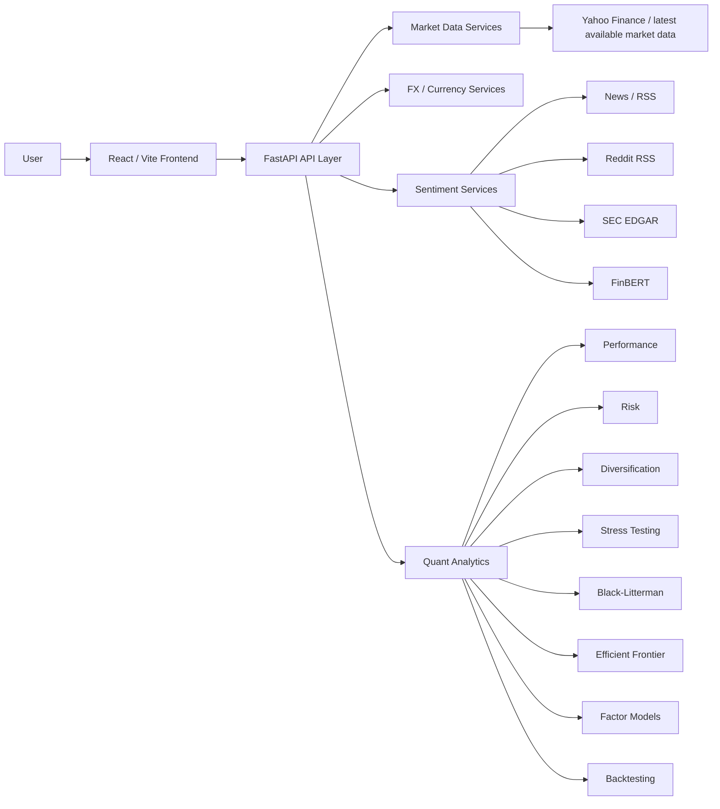

'# FinClarity

**Investment intelligence for retail and institutional-style portfolio analysis.**

FinClarity is a full-stack finance research platform that combines portfolio analytics, historical risk, FX-aware performance, sentiment intelligence and quantitative allocation tools in one interface.

The project was built as a portfolio/recruiter project to demonstrate how financial theory, data engineering and modern web development can be combined into a practical investment-research workflow.

> **Status:** Portfolio / research project  
> **Use case:** Education, research and technical demonstration  
> **Not investment advice:** Outputs are analytical estimates and should not be treated as recommendations.

---

## What FinClarity does

FinClarity has two user experiences:

### Retail Investor

The Retail workflow is designed to turn a user-entered portfolio into a clear set of diagnostics.

Core modules include:

- Portfolio dashboard
- Portfolio Action Centre
- Sentiment Insights
- Risk Analysis
- Historical Performance
- Diversification Analysis
- Stress Testing
- Exposure Intelligence
- Portfolio Health
- “Understand My Portfolio” education layer

The Retail experience emphasizes clear data-quality states such as **available**, **partial**, **unavailable**, **stale analysis**, and **no material findings**, rather than silently substituting missing data with neutral values.

### Institutional Investor

The Institutional workflow exposes more advanced quantitative research tools:

- Portfolio overview and shared portfolio state
- Efficient Frontier
- Sentiment Intelligence
- Black-Litterman allocation
- Factor Models
- Risk Analytics
- Backtesting
- Model Settings

Institutional model outputs persist across navigation so users can compare results without rerunning every model.

---

## Why this project is different

FinClarity is not a static dashboard. The project focuses on research integrity and model consistency.

### FX-aware portfolio analytics

Historical performance, risk, diversification and historical stress calculations are converted into the selected base currency before returns are calculated.

This avoids mixing local-currency returns across holdings.

Examples:

- USD security in GBP base: USD price history × USD/GBP FX history
- GBp/GBX instruments are normalized into GBP before portfolio conversion
- Benchmarks are converted into the same selected base currency
- Missing currency metadata is surfaced rather than silently guessed
- Historical FX alignment avoids future-data backfilling

### Explicit coverage handling

The application distinguishes between:

- complete analysis
- partial coverage
- unavailable data
- stale analysis
- no observations
- neutral sentiment
- negative sentiment

This matters because “no data” and “neutral” are not the same thing.

### Sentiment as research context

FinClarity uses finance-focused NLP to classify financial text and support:

- holding-level sentiment
- portfolio-level sentiment
- headline drill-down
- confidence-aware Portfolio Health logic
- institutional sentiment views

Sentiment is treated as research context, not as a price forecast.

### Shared portfolio state

Retail and Institutional workflows both use shared portfolio state across their respective modules so analytics remain internally consistent.

---

## Technical architecture



### Frontend

- React
- Vite
- React Router
- Lucide React
- route-level lazy loading
- route-intent prefetching
- persistent local model/portfolio state
- responsive dark research interface

### Backend

- Python
- FastAPI
- NumPy
- SciPy
- pandas
- yfinance
- PyTorch
- Transformers / FinBERT
- feedparser
- requests

---

## Quantitative modules

### Performance

Historical constant-weight, daily-rebalanced portfolio simulation using current portfolio weights.

The module is intentionally described as a **historical simulation**, not as the investor’s realized P&L.

### Risk

Includes portfolio diagnostics such as:

- annualized volatility
- maximum drawdown
- historical VaR
- CVaR
- Sharpe ratio
- Sortino ratio
- concentration
- correlation
- risk contribution

### Diversification

Combines concentration and correlation diagnostics to explain whether portfolio diversification is structural or superficial.

### Stress testing

Supports:

- historical worst-day analysis
- historical multi-day stress windows
- annualized volatility context
- deterministic scenario shocks

Historical return-based stress uses base-currency-consistent histories.

### Efficient Frontier

Uses portfolio optimization to explore risk/return trade-offs and Sharpe-maximizing allocations.

### Black-Litterman

Combines an equilibrium-style prior with investor/model views to produce a more stable expected-return framework than directly optimizing noisy historical means.

### Factor Models

Provides a structured framework for explaining portfolio return characteristics through factor exposures.

### Backtesting

Runs a historical strategy simulation with explicit model inputs and persisted results.

---

## Data and model limitations

FinClarity is intentionally transparent about data quality.

- Yahoo Finance is used as an unofficial/free market-data source.
- “Latest available” should not be interpreted as exchange-grade real-time data.
- Historical expected returns are noisy estimates.
- FinBERT measures language sentiment, not truth, causality or future returns.
- Company listing currency is not the same as economic currency exposure.
- Country metadata is company profile information, not revenue geography.
- Missing market or FX data can reduce model coverage.
- Historical simulations do not represent realized investor performance.
- Deterministic stress scenarios are assumptions, not forecasts.

---

## Engineering quality

The current release gate verifies:

- **166 backend tests passing**
- **24 unique route declarations**
- **23 registered frontend routes responding without server errors**
- **15 lazy-loaded routes aligned with route-prefetch mappings**
- frontend ESLint passing
- Vite production build passing
- all production JavaScript chunks below 500 kB
- largest JavaScript chunk approximately **291 kB**
- 36 CSS files with responsive/preference media queries
- 74 viewport breakpoint rules
- explicit stale-analysis and retry states
- zero unresolved installer placeholders
- no zero-byte active JS/JSX/CSS source files

Route-level code splitting reduced the largest initial JavaScript bundle from roughly **545 kB to 291 kB**, a reduction of approximately **47%**.

---

## Selected engineering decisions

### No silent reweighting in risk

Where missing data would materially distort portfolio risk, the risk workflow prefers explicit unavailability over silently removing holdings and renormalizing the rest.

### Coverage-aware synthesis

The Retail Action Centre excludes partially covered analytics from priority ranking where using them would create misleading confidence.

### Cache invalidation

Retail analysis caches are tied to the portfolio signature. When holdings or base currency change, saved analysis is treated as stale and the user is prompted to refresh it.

### Route-level performance optimization

The frontend uses:

- `React.lazy`
- `Suspense`
- branded route-loading UI
- intent-based route prefetching on hover, focus and touch
- slow-connection / Save-Data safeguards

---

## Screenshots

Add final screenshots to `docs/screenshots/` using these names:

```text
landing.png
retail-dashboard.png
retail-action-centre.png
retail-risk.png
institutional-overview.png
efficient-frontier.png
black-litterman.png
risk-analytics.png
```

Then embed them here before publishing the repository publicly.

---

## Running locally

### Backend

```bash
cd <path-to>/finclarity
source .venv/bin/activate
python -m uvicorn backend.main:app --reload --port 8010
```

Backend documentation:

```text
http://127.0.0.1:8010/docs
```

### Frontend

In a separate terminal:

```bash
cd <path-to>/finclarity
npm run dev
```

Frontend:

```text
http://localhost:5173
```

---

## Validation

```bash
python -m pytest -q
npm run lint
npm run build
```

The project also contains release QA scripts used to validate routing, frontend/backend availability, build health and UX-state handling.

---

## What I learned

Building FinClarity required combining finance concepts with software-engineering constraints.

The most important lessons were:

- why portfolio returns must be currency-consistent
- why missing data should not be treated as neutral data
- why historical simulations need precise labels
- how model outputs should persist across a research workflow
- how to expose uncertainty and partial coverage in financial UX
- how to optimize a React application without changing analytics logic
- how automated tests protect financial-model contracts during iterative development

---

## Future extensions

Potential future work includes:

- production-grade authenticated accounts
- institutional-quality market-data feeds
- broker/API portfolio import
- richer factor libraries
- transaction-aware realized performance
- portfolio rebalancing workflows
- cloud model hosting
- database-backed persistence
- scheduled research alerts

These are intentionally outside the current portfolio-project scope.

---

## Disclaimer

FinClarity is an educational and research project. It does not provide investment advice, personalized recommendations, brokerage services or guarantees regarding future investment performance.
'